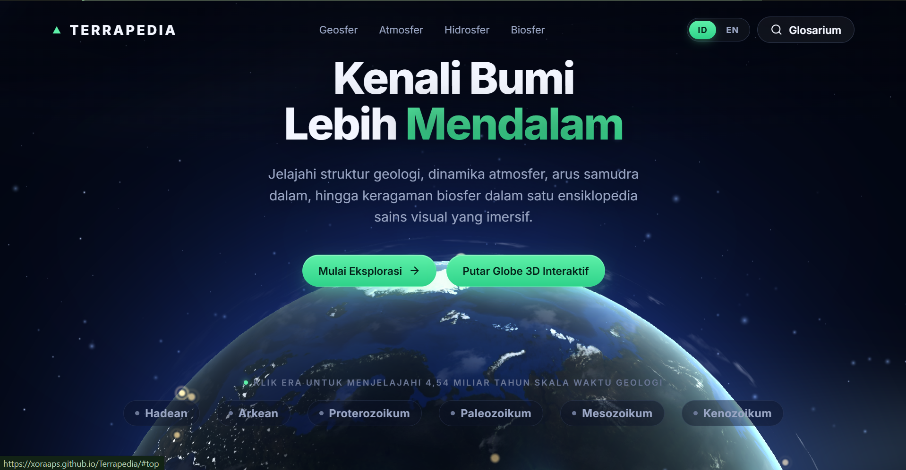

<div align="center">
  <h1>▲ TerraPedia</h1>
  <p><strong>Ensiklopedia Sains Kebumian & Observatorium Planet 3D Interaktif</strong></p>
  
  <p>
    <a href="https://USERNAME.github.io/Terrapedia/"><strong>🌐 Buka Live Demo »</strong></a>
  </p>

  
  
  
  
  
</div>

---

## 📖 Tentang Proyek
**TerraPedia** adalah aplikasi web ensiklopedia interaktif berbasis WebGL untuk mengeksplorasi struktur geologi, dinamika atmosfer, sirkulasi samudra dalam, hingga keragaman biosfer Bumi secara visual.



## ✨ Fitur Utama
* **🌍 Observatorium 3D Real-Time:** Render globe Bumi interaktif menggunakan **Three.js** dan custom **GLSL Shaders** lengkap dengan kontrol lapisan awan, lampu kota sisi malam, radar koordinat daratan, halo atmosfer, serta simulasi sudut sinar matahari siang/malam.
* **🏛️ 6 Pilar Sistem Planet:** Modul pembelajaran mendalam mengenai *Geosfer, Atmosfer, Biosfer, Vulkanologi, Magnetosfer,* dan *Hidrosfer* yang terhubung dengan simulasi 3D khusus per bab.
* **📊 Dasbor Telemetri Interaktif:** Visualisasi perbandingan profil gas atmosfer, cekungan samudra, komposisi unsur interior Bumi, dan produktivitas bioma.
* **⏳ Linimasa Skala Waktu Geologi:** Eksplorasi 4,54 miliar tahun sejarah Bumi dari Eon Hadean hingga Era Kenozoikum.
* **🔍 Glosarium Sains Bilingual (ID/EN):** Kamus 24 istilah geofisika dengan pencarian instan, *live keyword highlighting*, dan dukungan penuh Bahasa Indonesia serta Bahasa Inggris.

## 🛠️ Teknologi yang Digunakan
* **Core:** Semantic HTML5, Modern CSS3 (Glassmorphism, Custom Properties, Responsive Bottom-Sheet UI), Vanilla JavaScript (ES6 Modules)
* **3D & Graphics:** Three.js (`v0.143.0`), WebGL1Renderer, Post-Processing (`EffectComposer`, `UnrealBloomPass`), Custom GLSL Vertex/Fragment Shaders, `DRACOLoader`
* **Smooth Scrolling:** Lenis Smooth Scroll

## 🚀 Cara Menjalankan Secara Lokal
Karena proyek ini menggunakan ES Modules, jalankan melalui local development server:

1. Clone repository ini:
   ```bash
   git clone [https://github.com/USERNAME/terrapedia.git](https://github.com/USERNAME/terrapedia.git)
